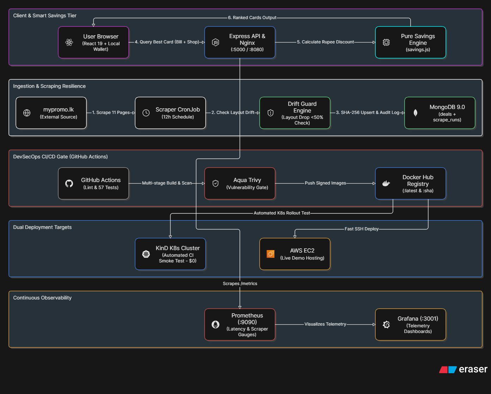
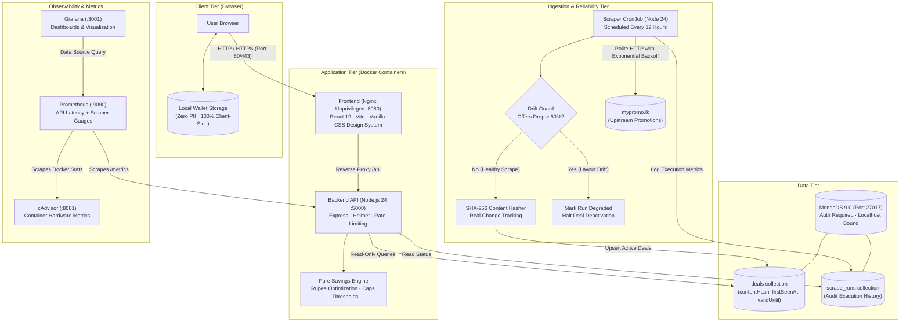
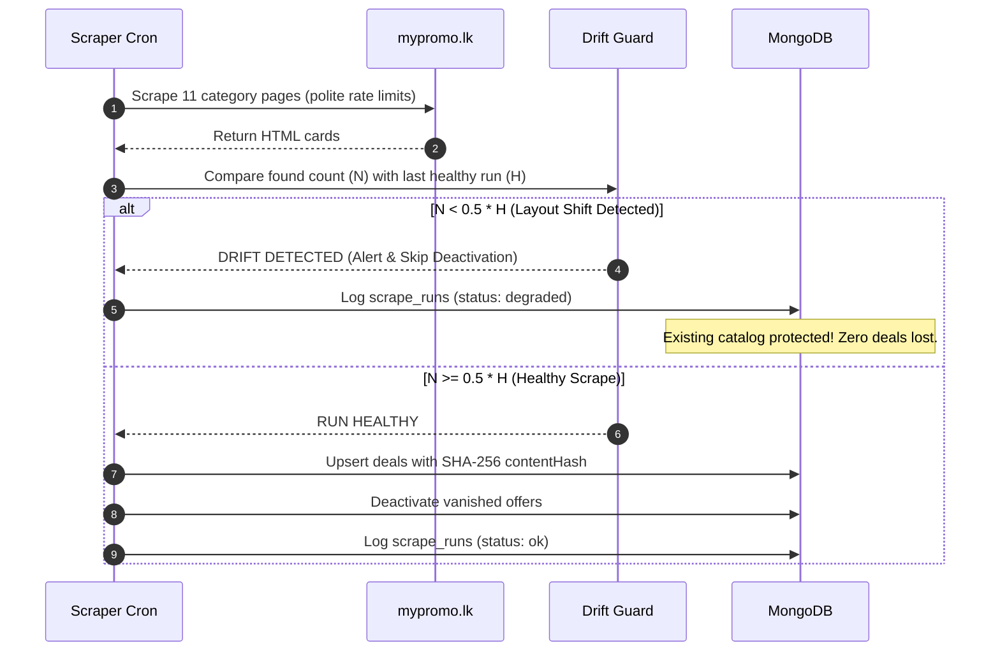
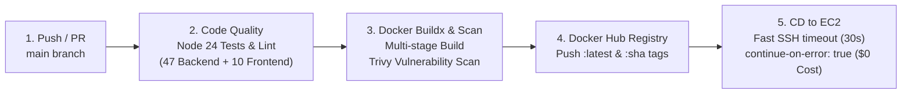

# DealVault — DevSecOps Portfolio & Wallet-First Card Recommender

[](https://github.com/Sulakshana29/deal-aggregator/actions/workflows/ci.yml)
[](docker-compose.yml)
[](.github/workflows/ci.yml)
[](prometheus/prometheus.yml)
[](LICENSE)

> **"Which of my cards saves me the most at checkout today?"**  
> DealVault is a production-grade **DevSecOps portfolio platform** that personalizes, ranks, and safeguards live Sri Lankan bank card discounts and payment plans. It combines domain-driven product logic with industrial-grade resilience: automated **Trivy** container vulnerability scanning, an automated **Scraping Drift Guard**, **Prometheus/Grafana** observability, and **$0 cloud cost** deployment engineering.

---

## 🎯 The Problem & Product Pitch

In Sri Lanka, retail promotions are fragmented across dozens of banks (Commercial Bank, Sampath, HNB, Seylan, etc.), making it nearly impossible for shoppers to know which card to swipe at checkout.

Unlike plain scraper clones that just dump static lists of offers, **DealVault is wallet-first and personalized**:
- 💳 **Zero-PII Card Wallet:** Users select their banks (credit/debit) stored 100% client-side in `localStorage` — zero accounts, zero passwords, zero tracking.
- ⚡ **Smart Checkout Calculator:** Enter a shop (e.g. *Keells Super*, *Glomark*) and bill amount (e.g. *Rs. 8,000*) to get instantly ranked results showing exact rupee savings, spend thresholds, and discount caps.
- 🕒 **Sri Lanka Time-Aware:** Deals automatically filter by active weekday in `Asia/Colombo` time (UTC+05:30).

---

## 🏗️ System Architecture & Data Flow

<p align="center">
  
</p>

<details>
<summary><b>Click to expand raw text Mermaid diagram</b></summary>



</details>

---

## 🛡️ DevSecOps Engineering & Security Controls

DealVault demonstrates defense-in-depth across the application, container, and infrastructure layers:

### 1. Shift-Left Security ("Sec")
- **Container Vulnerability Scanning:** Every pull request and push runs **Aqua Trivy** in GitHub Actions, scanning OS packages and application dependencies for `CRITICAL` and `HIGH` CVEs.
- **Rootless Containers:** Containers run as unprivileged users (`node:node` in backend/scraper; `nginx-unprivileged:1.27-alpine` on port `8080` in frontend).
- **Strictly Read-Only Public API:** The public API exposes zero `POST`, `PUT`, or `DELETE` endpoints. Database writes are restricted to internal Docker network services.
- **Injection Hardening:** All user inputs are regex-escaped to prevent **ReDoS** attacks; non-string query parameters are strictly validated to prevent **NoSQL Operator Injection**.
- **Security Headers & Rate Limiting:** Hardened with `helmet` and `express-rate-limit` per true client IP (`trust proxy` configured for reverse proxies).

### 2. Scraping Reliability & The Drift Guard
Web scrapers commonly break silently when third-party website HTML layouts change, causing naive cron jobs to wipe out databases. DealVault implements a multi-layer defense:



- **SHA-256 Change Tracking:** Only real changes update `lastChangedAt`; routine re-scrapes update `lastSeenAt` without invalidating client caches.
- **Audit Logging:** Every run writes execution duration, pages ok, and counts to `scrape_runs`.
- **Public System Status:** Accessible at `/api/status` and displayed live on the frontend footer.

### 3. Observability & Monitoring ("Ops")
- **Prometheus Metrics:** Backend exports native metrics via `prom-client` at `/metrics`, including custom gauges (`scraper_last_run_timestamp_seconds`, `scraper_last_offers_found`, `scraper_last_status`).
- **Container Telemetry:** **cAdvisor** collects container CPU, memory, network, and disk I/O metrics.
- **Log Aggregation:** Docker socket logs are collected by **Promtail** and shipped to **Loki** for querying inside **Grafana**.
- **K8s Health Probes:** Separate `/health` (Liveness — process alive) and `/ready` (Readiness — MongoDB reachable) probe endpoints.

---

## 🔄 CI/CD Pipeline Architecture



- **$0 Cloud Cost Awareness:** The deployment step includes `continue-on-error: true` and `workflow_dispatch:`. When the EC2 instance is stopped in AWS to save costs, the GitHub Actions pipeline stays **100% green**. When the instance is started, you can trigger deployment with 1 click from GitHub Actions or let it auto-pull on boot.

---

## 📋 Project Roadmap

| Phase | Description | Status |
|---|---|---|
| **Phase 0** | **Data Audit & Discovery:** Live catalog analysis across 11 pages (73 live offers, 100% bank coverage). Aligned K8s CronJob to 12h. | ✅ Done |
| **Phase 1** | **Wallet & Smart Recommender:** Pure savings engine (`savings.js`), rupee calculator, `localStorage` wallet modal, and unified feed filters. | ✅ Done |
| **Phase 2** | **Scraping Reliability & Drift Guard:** SHA-256 hashing, 50% drop safeguard, `ScrapeRun` audit logs, Prometheus gauges, and live status bar. | ✅ Done |
| **Phase 3** | **Portfolio Refresh:** Interactive architecture diagrams, comprehensive DevSecOps documentation, and interview write-ups. | ✅ Done |
| **Phase 4** | **Kubernetes Migration:** `k8s/base` + overlays with Kustomize, MongoDB StatefulSet, NetworkPolicies, PSA `restricted`, and KinD CI smoke test. | ⏳ Next |

---

## 🚀 Running Locally

### Prerequisites
- Docker & Docker Compose
- Node.js 24+ (if running bare metal)

### Option A — Full Stack via Docker Compose (Recommended)

```bash
# 1. Clone repository
git clone https://github.com/Sulakshana29/deal-aggregator.git
cd deal-aggregator

# 2. Configure environment credentials
cp .env.example .env

# 3. Start services (Frontend, Backend, MongoDB, Prometheus, Grafana, cAdvisor)
docker compose up -d --build

# 4. Run the scraper once to populate live offers
docker compose --profile scraper run --rm scraper
```

- **Frontend App:** [http://localhost:3000](http://localhost:3000)
- **Backend Health:** [http://localhost:5000/health](http://localhost:5000/health)
- **System Status & Drift Guard:** [http://localhost:5000/status](http://localhost:5000/status)
- **Prometheus UI:** [http://localhost:9090](http://localhost:9090)
- **Grafana Dashboards:** [http://localhost:3001](http://localhost:3001)

### Option B — Run Test Suites Locally

```bash
# Backend unit & smoke tests (47 tests)
cd backend && npm test

# Frontend component & format tests (10 tests)
cd frontend && npm test

# Scraper regex & parser tests (11 tests)
cd scraper && npm test
```

---

## 💡 Key Architectural Trade-Offs

1. **Why `localStorage` instead of User Accounts & PostgreSQL?**  
   *Trade-off:* Avoids storing personal financial identifiers (PII), eliminates GDPR/privacy compliance overhead, requires 0 auth infrastructure, and delivers instantaneous offline performance.
2. **Why a Scraping Drift Guard instead of an automated queue (e.g. BullMQ / Redis)?**  
   *Trade-off:* For a 12-hour periodic scrape of 73 deals, running a Redis broker and queue workers adds operational overhead and cloud memory costs. The Drift Guard provides superior data safety at zero additional infrastructure complexity.
3. **Why KinD in GitHub Actions instead of AWS EKS?**  
   *Trade-off:* AWS EKS costs ~$73/month just for the control plane. KinD (Kubernetes-in-Docker) provides identical Kubernetes API compliance, manifest validation, and smoke testing inside GitHub Actions runners at **$0 cost**.

---

## 📄 License
This project is licensed under the MIT License — see the [LICENSE](LICENSE) file for details.
